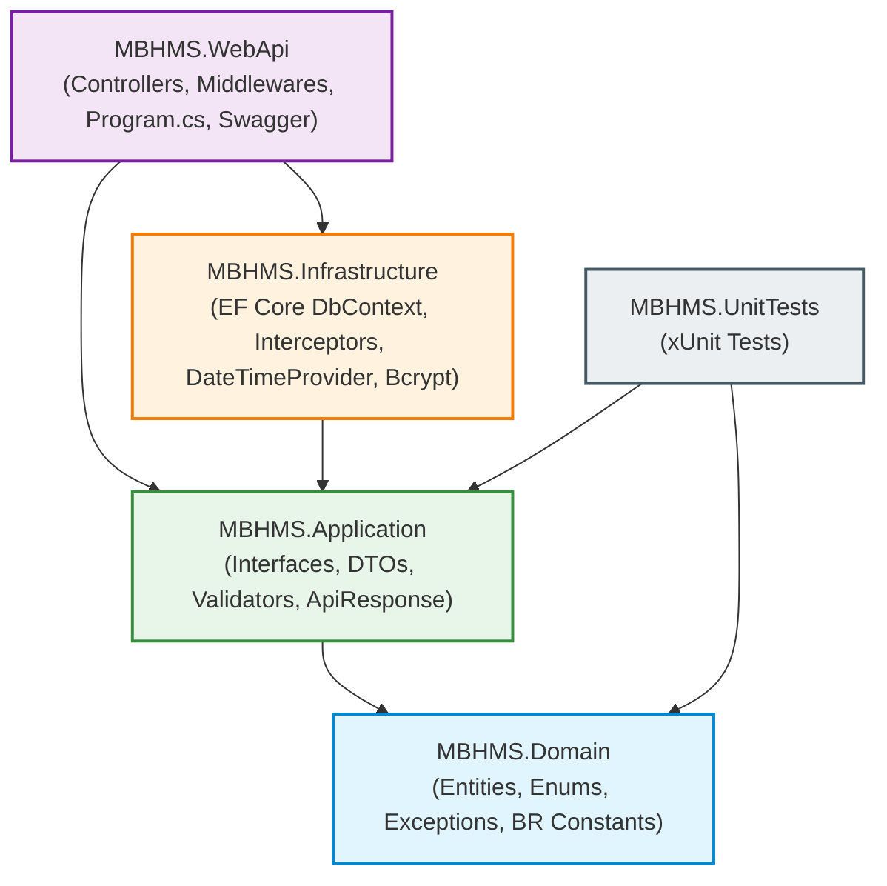

# Daily Implementation Plan - DAY-007

## 1. Objective (Mục tiêu cốt lõi)

Khởi tạo bộ khung mã nguồn Backend chuẩn Clean Architecture gồm 4 tầng tách biệt (`MBHMS.Domain`, `MBHMS.Application`, `MBHMS.Infrastructure`, `MBHMS.WebApi`) kèm dự án kiểm thử `MBHMS.UnitTests` trên nền tảng **.NET 10 SDK**, cài đặt đầy đủ các thư viện NuGet nền tảng, thiết lập Dependency Injection module hóa cho từng tầng, khóa cứng múi giờ Việt Nam `Asia/Ho_Chi_Minh` (UTC+7 theo `NFR-13`), cấu hình Swagger UI hỗ trợ xác thực JWT Bearer (`NFR-05`), xây dựng Global Exception Handling theo chuẩn .NET 10 `IExceptionHandler` trả về JSON tiếng Việt đồng nhất (`NFR-12`), và phát hành endpoint `GET /api/health` sẵn sàng cho việc kết nối PostgreSQL và viết logic nghiệp vụ.

---

## 2. Tasks (Thứ tự thực hiện chi tiết)

### Task 1: Khởi động & Chốt mục tiêu ngày (08:30 – 09:00)
- **Cập nhật Kanban Board:** Chuyển 3 thẻ công việc của Ngày 7 từ cột `Backlog` sang cột `Today`:
  1. *Khởi tạo Solution .NET 10 chia 4 tầng (Domain, Application, Infrastructure, WebApi) + UnitTests*
  2. *Cài đặt các NuGet Packages cốt lõi & cấu hình Dependency Injection*
  3. *Thiết lập Swagger (hỗ trợ JWT), Global Exception Middleware & Múi giờ UTC+7*
- **Điểm lại các ràng buộc kỹ thuật cốt lõi cần nhúng sẵn vào khung nền:**
  - `NFR-04`: Chuẩn bị thư viện mã hóa mật khẩu Bcrypt với cost factor $\ge 10$.
  - `NFR-05`: Thiết lập Swagger UI hỗ trợ JWT Bearer Token để kiểm thử phân quyền 4 Roles (`Owner`, `Manager`, `Tenant`, `Guest`).
  - `NFR-11`: Xây dựng sẵn khung `AuditableEntitySaveChangesInterceptor` để tự động lưu Audit Log cho Hợp đồng và Hóa đơn.
  - `NFR-12`: Chuẩn hóa cấu trúc phản hồi API (`ApiResponse<T>`) và thông báo lỗi bằng tiếng Việt chuẩn.
  - `NFR-13`: Khóa cứng múi giờ `Asia/Ho_Chi_Minh` (UTC+7) trên toàn bộ dịch vụ backend, tránh lệch múi giờ khi deploy lên Render/Railway.

### Task 2: Deep Work 1 – Khởi tạo Cấu trúc 4 Tầng Clean Architecture & Projects (09:00 – 12:00)
- **Task 2.1: Khởi tạo Solution & 5 Projects trong `backend/`:**
  - `MBHMS.Domain` (Class Library - net10.0): Tầng lõi trong cùng, độc lập hoàn toàn, không phụ thuộc bất kỳ thư viện bên thứ 3 nào.
  - `MBHMS.Application` (Class Library - net10.0): Tầng ứng dụng nghiệp vụ, tham chiếu `MBHMS.Domain`.
  - `MBHMS.Infrastructure` (Class Library - net10.0): Tầng hạ tầng dịch vụ & cơ sở dữ liệu, tham chiếu `MBHMS.Application`.
  - `MBHMS.WebApi` (ASP.NET Core Web API - net10.0): Tầng giao tiếp REST API, tham chiếu `MBHMS.Application` và `MBHMS.Infrastructure`.
  - `MBHMS.UnitTests` (xUnit Project - net10.0): Nằm tại `backend/tests/MBHMS.UnitTests`, tham chiếu `MBHMS.Domain` và `MBHMS.Application`.
  - Liên kết tất cả 5 projects vào file solution `backend/MBHMS.sln`.
- **Task 2.2: Xây dựng các thành phần nền tảng của tầng `MBHMS.Domain`:**
  - `Common/BaseEntity.cs`: Định nghĩa thực thể gốc với khóa chính `Guid Id`.
  - `Common/AuditableEntity.cs`: Kế thừa `BaseEntity`, bổ sung `CreatedAt`, `CreatedBy`, `UpdatedAt`, `UpdatedBy` (phục vụ `NFR-11`).
  - `Common/IDateTimeProvider.cs`: Interface lấy thời gian chuẩn hệ thống.
  - `Enums/`: Khai báo toàn bộ các enum nghiệp vụ cốt lõi:
    - `UserRole`: `Owner = 1`, `Manager = 2`, `Tenant = 3`, `Guest = 4`.
    - `RoomType`: `Single = 1`, `Double = 2`, `Family = 3`.
    - `RoomStatus`: `Available = 1`, `Rented = 2`, `Maintenance = 3`, `Reserved = 4`.
    - `InvoiceStatus`: `Pending = 1`, `Paid = 2`, `Overdue = 3`, `Cancelled = 4`.
    - `TicketStatus`: `Open = 1`, `Processing = 2`, `Resolved = 3`, `Closed = 4`.
    - `TicketPriority`: `Low = 1`, `Medium = 2`, `High = 3`, `Urgent = 4`.
    - `PaymentMethod`: `SePayVietQR = 1`, `Cash = 2`.
    - `NotificationType`: `Invoice = 1`, `Contract = 2`, `Ticket = 3`, `General = 4`.
  - `Exceptions/`: Các exception nghiệp vụ kế thừa từ `Exception`:
    - `DomainException.cs`, `BusinessRuleException.cs`, `NotFoundException.cs`, `ForbiddenAccessException.cs`, `ValidationException.cs`.
  - `Constants/BusinessRulesConstants.cs`: Lưu trữ định lượng 14 quy tắc nghiệp vụ (`BR-01` đến `BR-14`): đơn giá điện 3.500đ/kWh, nước 100.000đ/người, wifi 100.000đ/phòng, rác 50.000đ/phòng, gửi xe 120.000đ/xe, ngày chốt hóa đơn 28, hạn thanh toán ngày 5, thời hạn báo trước chấm dứt HĐ 30 ngày, tỷ lệ phạt cọc 50%.
- **Task 2.3: Xây dựng các Interfaces & Module DI cho tầng `MBHMS.Application`:**
  - `Common/Interfaces/`:
    - `IApplicationDbContext.cs`: Khai báo hợp đồng truy cập cơ sở dữ liệu.
    - `ICurrentUserService.cs`: Trích xuất thông tin `UserId`, `Email`, `Role`, `AssignedBuildingIds` từ JWT Token (`BR-14`, `NFR-05`).
    - `ISePayService.cs`, `IStorageService.cs`, `IEmailService.cs`: Hợp đồng cho các dịch vụ bên ngoài.
  - `Common/Models/`:
    - `ApiResponse<T>.cs`: Chuẩn hóa định dạng JSON Response cho toàn hệ thống (`Success`, `Message`, `Data`, `Errors`, `Timestamp`).
    - `PagedResponse<T>.cs`: Chuẩn hóa dữ liệu phân trang danh sách.
  - `DependencyInjection.cs`: Phương thức mở rộng `AddApplicationServices()` đăng ký FluentValidation và các dịch vụ tầng Application.
- **Task 2.4: Xây dựng khung Hạ tầng & Module DI cho tầng `MBHMS.Infrastructure`:**
  - `DependencyInjection.cs`: Phương thức mở rộng `AddInfrastructureServices(this IServiceCollection services, IConfiguration configuration)`.
  - `Persistence/AppDbContext.cs`: Khung sơ bộ DbContext kế thừa `DbContext` và triển khai `IApplicationDbContext`.
  - `Persistence/Interceptors/AuditableEntitySaveChangesInterceptor.cs`: Tự động điền ngày giờ UTC+7 và User tác động khi `SaveChanges` (`NFR-11`).
  - `Services/DateTimeProvider.cs`: Triển khai `IDateTimeProvider` cố định múi giờ `Asia/Ho_Chi_Minh` (UTC+7) (`NFR-13`).
  - `Security/BcryptPasswordHasher.cs`: Triển khai hàm hash mật khẩu Bcrypt với work factor $11 \ge 10$ (`NFR-04`).

### Task 3: Deep Work 2 – Cài đặt Thư viện Lõi, Swagger & Chuẩn hóa Hệ thống (13:30 – 17:00)
- **Task 3.1: Cài đặt các gói NuGet nền tảng cho từng Project:**
  - **Tầng Infrastructure:**
    - `Npgsql.EntityFrameworkCore.PostgreSQL` (v9.x/v10.x tương thích .NET 10)
    - `Microsoft.EntityFrameworkCore.Tools`
    - `BCrypt.Net-Next` (hỗ trợ hash mật khẩu NFR-04)
  - **Tầng Application:**
    - `FluentValidation.DependencyInjectionExtensions`
  - **Tầng WebApi:**
    - `Microsoft.AspNetCore.Authentication.JwtBearer`
    - `Swashbuckle.AspNetCore` (hoặc tích hợp Scalar/OpenAPI .NET 10)
- **Task 3.2: Khóa cứng Múi giờ Việt Nam (`Asia/Ho_Chi_Minh` / UTC+7 theo `NFR-13`):**
  - Đảm bảo `DateTimeProvider.Now` và `DateTimeProvider.UtcNow` luôn quy đổi chuẩn sang múi giờ `Asia/Ho_Chi_Minh` (Windows ID: `SE Asia Standard Time`, IANA ID: `Asia/Ho_Chi_Minh`).
  - Đăng ký `IDateTimeProvider` dạng `Singleton` trong DI Container để toàn bộ ứng dụng sử dụng nhất quán.
- **Task 3.3: Xây dựng Global Exception Handler (`IExceptionHandler` trong .NET 10):**
  - Tạo `MBHMS.WebApi/Middlewares/GlobalExceptionHandler.cs` triển khai giao diện `IExceptionHandler`.
  - Xử lý phân loại ngoại lệ và trả về mã HTTP chuẩn:
    - `BusinessRuleException` $\rightarrow$ HTTP 400 Bad Request
    - `ValidationException` $\rightarrow$ HTTP 400 Bad Request kèm chi tiết trường dữ liệu vi phạm
    - `ForbiddenAccessException` $\rightarrow$ HTTP 403 Forbidden
    - `NotFoundException` $\rightarrow$ HTTP 404 Not Found
    - `UnauthorizedAccessException` $\rightarrow$ HTTP 401 Unauthorized
    - Các ngoại lệ chưa kiểm soát khác $\rightarrow$ HTTP 500 Internal Server Error
  - Đảm bảo nội dung phản hồi tuân thủ schema `ApiResponse<T>` với `Success = false` và thông báo tiếng Việt thân thiện (`NFR-12`).
- **Task 3.4: Cấu hình Swagger UI hỗ trợ JWT Bearer Authorization:**
  - Cấu hình `AddSwaggerGen` trong `Program.cs` thiết lập Security Definition `Bearer` (`JWT Authorization header using the Bearer scheme`).
  - Kích hoạt nút `Authorize` trên giao diện Swagger UI để nhập `Bearer {token}`, hỗ trợ kiểm thử phân quyền 4 Roles trực tiếp trên trình duyệt (`NFR-05`).
- **Task 3.5: Cấu hình `Program.cs` & Xây dựng `HealthController`:**
  - Gắn kết toàn bộ các dịch vụ: Application, Infrastructure, CORS, Exception Handler, Authentication, Authorization, Swagger.
  - Tạo Controller `MBHMS.WebApi/Controllers/HealthController.cs` với endpoint `GET /api/health`:
    - Trả về mã HTTP 200 kèm `status: "Healthy"`, `timestamp: DateTimeProvider.Now` (UTC+7), `timeZone: "Asia/Ho_Chi_Minh (UTC+7)"`, `version: "1.0.0"`.
- **Task 3.6: Viết Bộ Unit Tests Khởi đầu (`MBHMS.UnitTests`):**
  - `DateTimeProviderTests.cs`: Kiểm thử `DateTimeProvider` luôn trả về đúng độ lệch offset `+07:00` bất kể môi trường hệ điều hành.
  - `BusinessRulesConstantsTests.cs`: Kiểm thử các hằng số tính toán tiền điện (`BR-01`), tiền nước (`BR-02`), công thức phạt cọc 50% (`BR-11`) khớp chính xác với SRS.

### Task 4: Nghiệm thu cuối ngày (Definition of Done) & Commit (17:00 – 17:30)
- Thực hiện chạy kiểm thử tự động: `dotnet test backend/MBHMS.sln` $\rightarrow$ Toàn bộ tests đạt **PASS**.
- Chạy biên dịch toàn bộ solution: `dotnet build backend/MBHMS.sln` $\rightarrow$ **0 Errors, 0 Warnings**.
- Kiểm tra Swagger UI và gọi thử endpoint `GET /api/health` trả về JSON đúng múi giờ Việt Nam.
- Chạy script kiểm toán phạm vi file: `powershell -File scripts/verify-scope.ps1 -PlanFile docs/planning/daily-plans/DAY-007.md`.
- Ghi nhận chi tiết kết quả thực hiện vào `docs/development/DEVELOPMENT_LOG.md` theo nguyên tắc Append-Only.
- Thực hiện commit code chuẩn Conventional Commits lên nhánh `develop`:
  `feat(backend): scaffold .NET 10 Clean Architecture solution with Swagger and UTC+7 config`
- Chuyển toàn bộ 3 thẻ công việc Ngày 7 trên bảng Kanban sang cột `Done`.

---

## 3. Target Files

Phạm vi file được phép tạo hoặc chỉnh sửa trong ngày:

### Create
- docs/planning/daily-plans/DAY-007.md
- backend/MBHMS.sln
- backend/src/MBHMS.Domain/MBHMS.Domain.csproj
- backend/src/MBHMS.Domain/Common/BaseEntity.cs
- backend/src/MBHMS.Domain/Common/AuditableEntity.cs
- backend/src/MBHMS.Domain/Common/IDateTimeProvider.cs
- backend/src/MBHMS.Domain/Constants/BusinessRulesConstants.cs
- backend/src/MBHMS.Domain/Enums/UserRole.cs
- backend/src/MBHMS.Domain/Enums/RoomType.cs
- backend/src/MBHMS.Domain/Enums/RoomStatus.cs
- backend/src/MBHMS.Domain/Enums/InvoiceStatus.cs
- backend/src/MBHMS.Domain/Enums/TicketStatus.cs
- backend/src/MBHMS.Domain/Enums/TicketPriority.cs
- backend/src/MBHMS.Domain/Enums/PaymentMethod.cs
- backend/src/MBHMS.Domain/Enums/NotificationType.cs
- backend/src/MBHMS.Domain/Exceptions/DomainException.cs
- backend/src/MBHMS.Domain/Exceptions/BusinessRuleException.cs
- backend/src/MBHMS.Domain/Exceptions/NotFoundException.cs
- backend/src/MBHMS.Domain/Exceptions/ForbiddenAccessException.cs
- backend/src/MBHMS.Domain/Exceptions/ValidationException.cs
- backend/src/MBHMS.Application/MBHMS.Application.csproj
- backend/src/MBHMS.Application/DependencyInjection.cs
- backend/src/MBHMS.Application/Common/Models/ApiResponse.cs
- backend/src/MBHMS.Application/Common/Models/PagedResponse.cs
- backend/src/MBHMS.Application/Common/Interfaces/IApplicationDbContext.cs
- backend/src/MBHMS.Application/Common/Interfaces/ICurrentUserService.cs
- backend/src/MBHMS.Application/Common/Interfaces/ISePayService.cs
- backend/src/MBHMS.Application/Common/Interfaces/IStorageService.cs
- backend/src/MBHMS.Application/Common/Interfaces/IEmailService.cs
- backend/src/MBHMS.Infrastructure/MBHMS.Infrastructure.csproj
- backend/src/MBHMS.Infrastructure/DependencyInjection.cs
- backend/src/MBHMS.Infrastructure/Services/DateTimeProvider.cs
- backend/src/MBHMS.Infrastructure/Security/BcryptPasswordHasher.cs
- backend/src/MBHMS.Infrastructure/Persistence/AppDbContext.cs
- backend/src/MBHMS.Infrastructure/Persistence/Interceptors/AuditableEntitySaveChangesInterceptor.cs
- backend/src/MBHMS.WebApi/MBHMS.WebApi.csproj
- backend/src/MBHMS.WebApi/Program.cs
- backend/src/MBHMS.WebApi/Middlewares/GlobalExceptionHandler.cs
- backend/src/MBHMS.WebApi/Controllers/BaseApiController.cs
- backend/src/MBHMS.WebApi/Controllers/HealthController.cs
- backend/src/MBHMS.WebApi/Properties/launchSettings.json
- backend/src/MBHMS.WebApi/appsettings.json
- backend/src/MBHMS.WebApi/appsettings.Development.json
- backend/tests/MBHMS.UnitTests/MBHMS.UnitTests.csproj
- backend/tests/MBHMS.UnitTests/Common/DateTimeProviderTests.cs
- backend/tests/MBHMS.UnitTests/Domain/BusinessRulesConstantsTests.cs

### Modify
- backend/src/MBHMS.WebApi/appsettings.Example.json

### Workflow Files
- docs/development/DEVELOPMENT_LOG.md

*(Mọi file không nằm trong danh sách này đều nằm ngoài phạm vi được phép chỉnh sửa. Agent phải dừng lại và yêu cầu phê duyệt nếu phát sinh file mới).*

---

## 4. Technical Specifications

### Sơ đồ Kiến trúc 4 Tầng Clean Architecture (.NET 10)



### Chuẩn Phản hồi API (API Response Schema) & Xử lý Ngoại lệ

Cấu trúc JSON phản hồi tiêu chuẩn cho toàn bộ API (`ApiResponse<T>`):
```json
{
  "success": true,
  "message": "Thao tác thành công",
  "data": { ... },
  "errors": null,
  "timestamp": "2026-11-17T21:30:00+07:00"
}
```

Khi phát sinh lỗi (HTTP 400, 401, 403, 404, 500):
```json
{
  "success": false,
  "message": "Thông báo lỗi bằng tiếng Việt dễ hiểu",
  "data": null,
  "errors": [
    {
      "field": "CitizenId",
      "message": "Số căn cước công dân phải gồm đúng 12 chữ số"
    }
  ],
  "timestamp": "2026-11-17T21:30:00+07:00"
}
```

### Đặc tả Endpoint HealthCheck (`GET /api/health`)

- **URL:** `/api/health`
- **Method:** `GET`
- **Quyền truy cập:** Public (Anonymous)
- **Response Payload (HTTP 200 OK):**
```json
{
  "success": true,
  "message": "Hệ thống MBHMS Backend đang hoạt động ổn định",
  "data": {
    "status": "Healthy",
    "service": "MBHMS.WebApi",
    "version": "1.0.0",
    "timeZone": "Asia/Ho_Chi_Minh (UTC+7)",
    "serverTime": "2026-11-17T21:30:00.123+07:00"
  },
  "errors": null,
  "timestamp": "2026-11-17T21:30:00.123+07:00"
}
```

### Cấu hình Múi giờ Cố định `Asia/Ho_Chi_Minh` (NFR-13)

```csharp
public interface IDateTimeProvider
{
    DateTime Now { get; }
    DateTime UtcNow { get; }
    DateTimeOffset NowOffset { get; }
    DateOnly Today { get; }
}

public class DateTimeProvider : IDateTimeProvider
{
    private static readonly TimeZoneInfo VietnamTimeZone = GetVietnamTimeZone();

    public DateTime Now => TimeZoneInfo.ConvertTimeFromUtc(DateTime.UtcNow, VietnamTimeZone);
    public DateTime UtcNow => DateTime.UtcNow;
    public DateTimeOffset NowOffset => TimeZoneInfo.ConvertTime(DateTimeOffset.UtcNow, VietnamTimeZone);
    public DateOnly Today => DateOnly.FromDateTime(Now);

    private static TimeZoneInfo GetVietnamTimeZone()
    {
        try
        {
            // Hỗ trợ Linux/macOS/Render/Railway (IANA ID)
            return TimeZoneInfo.FindSystemTimeZoneById("Asia/Ho_Chi_Minh");
        }
        catch (TimeZoneNotFoundException)
        {
            // Hỗ trợ Windows (Standard Time ID)
            return TimeZoneInfo.FindSystemTimeZoneById("SE Asia Standard Time");
        }
    }
}
```

---

## 5. Business Rules & Ràng Buộc Kỹ Thuật Tuân Thủ

- **NFR-04 (Bảo mật mật khẩu):** Tích hợp thư viện `BCrypt.Net-Next`, cấu hình work factor tối thiểu 11 ($\ge 10$), không lưu mật khẩu dạng plain text.
- **NFR-05 (Bảo mật phân quyền):** Cấu hình Swagger hỗ trợ JWT Bearer scheme, sẵn sàng cho việc xác thực và kiểm tra vai trò tại mọi endpoint.
- **NFR-11 (Audit Log):** Chuẩn bị sẵn lớp `AuditableEntitySaveChangesInterceptor` để tự động ghi log thao tác thay đổi dữ liệu của Hợp đồng và Hóa đơn.
- **NFR-12 (Ngôn ngữ & Định dạng):** Toàn bộ thông điệp trả về từ API và Exception Handler phải được viết bằng tiếng Việt có dấu chuẩn mực, thân thiện với người dùng.
- **NFR-13 (Múi giờ cố định):** Toàn bộ hệ thống phải sử dụng thống nhất múi giờ Việt Nam `Asia/Ho_Chi_Minh` (UTC+7) qua `IDateTimeProvider`.
- **BR-01 đến BR-14 (Hằng số quy tắc):** Đóng gói toàn bộ các tham số định lượng của 14 quy tắc nghiệp vụ trong `BusinessRulesConstants.cs` ở tầng Domain.

---

## 6. Expected Outputs (Sản phẩm bàn giao)

1. Cấu trúc Solution `backend/MBHMS.sln` hoàn chỉnh với 4 projects Clean Architecture + 1 project UnitTests biên dịch thành công 100%.
2. Bộ NuGet packages cốt lõi được cài đặt chính xác vào từng tầng tương ứng.
3. Module `DependencyInjection.cs` gọn gàng tại Application và Infrastructure.
4. Múi giờ `Asia/Ho_Chi_Minh` được khóa cứng qua `IDateTimeProvider`.
5. Global Exception Handler chuẩn .NET 10 `IExceptionHandler` phản hồi JSON tiếng Việt thống nhất.
6. Giao diện Swagger UI hoạt động, hiển thị thông tin API và nút `Authorize` Bearer JWT.
7. Endpoint `GET /api/health` trả về kết quả `Healthy` và giờ Việt Nam (UTC+7).
8. Bộ Unit Tests khởi đầu chạy đạt 100% PASS.
9. Báo cáo kiểm toán phạm vi `scripts/verify-scope.ps1` đạt PASS.
10. Nhật ký phát triển `docs/development/DEVELOPMENT_LOG.md` được cập nhật đầy đủ.

---

## 7. Acceptance Criteria (Tiêu chí nghiệm thu DoD)

- [x] Lệnh `dotnet build backend/MBHMS.sln` chạy thành công với **0 Errors, 0 Warnings**.
- [x] Lệnh `dotnet test backend/MBHMS.sln` thực thi toàn bộ unit tests đạt kết quả **PASS**.
- [x] Tầng `MBHMS.Domain` hoàn toàn thuần C#, không tham chiếu bất kỳ thư viện bên ngoài nào.
- [x] Tầng `MBHMS.Application` tham chiếu `Domain`, tầng `MBHMS.Infrastructure` tham chiếu `Application`, tầng `MBHMS.WebApi` tham chiếu `Application` và `Infrastructure`.
- [x] Dependency Injection được đóng gói qua `AddApplicationServices()` và `AddInfrastructureServices()`.
- [x] Lớp `DateTimeProvider` trả về đúng thời gian chuẩn `Asia/Ho_Chi_Minh` (offset `+07:00`).
- [x] Endpoint `GET /api/health` trả về HTTP 200 kèm JSON đúng định dạng `ApiResponse<T>` và serverTime có offset `+07:00`.
- [x] Swagger UI khởi chạy thành công tại `/swagger` (hoặc `/scalar/v1`), có tích hợp nút `Authorize` cho Bearer Token.
- [x] `GlobalExceptionHandler` bắt đúng các ngoại lệ `BusinessRuleException`, `NotFoundException`, `ForbiddenAccessException` và trả về JSON tiếng Việt chuẩn `NFR-12`.
- [x] Kiểm toán scope bằng script `scripts/verify-scope.ps1` đạt kết quả **PASS**.
- [x] Nhật ký `docs/development/DEVELOPMENT_LOG.md` được cập nhật đầy đủ (tuân thủ Append-Only).
- [x] Mã nguồn được commit chuẩn Conventional Commits lên nhánh `develop`: `feat(backend): scaffold .NET 10 Clean Architecture solution with Swagger and UTC+7 config`.

---

## 8. Strict Restrictions

- Chỉ tạo và chỉnh sửa các file thuộc danh sách **Target Files** đã được phê duyệt.
- Tuyệt đối không cài đặt thêm các package ngoài danh sách đã thống nhất mà không có lý do chính đáng.
- Giữ nguyên cấu trúc Clean Architecture chuẩn, không tạo các tham chiếu ngược (ví dụ: Domain không được tham chiếu Application hay Infrastructure).
- Tuân thủ nguyên tắc **Append-Only** cho file `DEVELOPMENT_LOG.md`.

---

## 9. Completion Report Requirements

Khi hoàn thành ngày làm việc, cập nhật `docs/development/DEVELOPMENT_LOG.md` bao gồm:
- Tóm tắt kết quả hoàn thành của từng task trong ngày.
- Bảng tổng hợp cấu trúc Solution, Projects và các Package đã cài đặt.
- Kết quả chạy lệnh build `dotnet build` và test `dotnet test`.
- Kết quả chạy script kiểm toán scope `scripts/verify-scope.ps1`.
- Kết quả gọi thử nghiệm endpoint `GET /api/health`.
- Mã commit Git và trạng thái công việc trên bảng Kanban.
