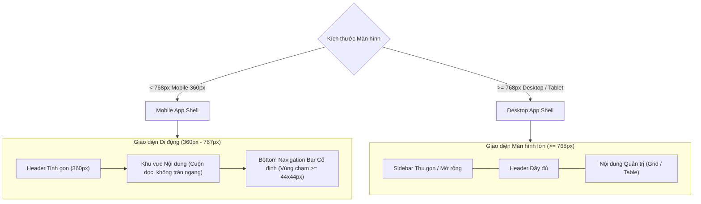

# Daily Implementation Plan - DAY-008

## 1. Objective (Mục tiêu cốt lõi)

Khởi tạo cấu trúc ứng dụng Frontend bằng **Next.js (App Router, TypeScript, Tailwind CSS)** chuẩn **Mobile-First**, tích hợp thư viện component **shadcn/ui**, thiết lập cơ sở dữ liệu ngoại tuyến **Dexie.js (IndexedDB)** phục vụ ghi số điện Offline (`FR-18`, `NFR-09`), cấu hình font tiếng Việt chuẩn mực (*Be Vietnam Pro* theo `NFR-12`) loại bỏ định kiến AI generic, ứng dụng skill **`impeccable`** để định hình tệp bối cảnh sản phẩm [PRODUCT.md](file:///d:/TaDuss/Boarding-House-Management/PRODUCT.md) và hệ thống thiết kế [DESIGN.md](file:///d:/TaDuss/Boarding-House-Management/DESIGN.md), xây dựng khung giao diện đáp ứng linh hoạt từ $360\text{px}$ (`NFR-08`) với điều hướng $\le 3$ chạm (`NFR-07`), và kết nối thông suốt với Backend .NET 10 qua API Client và endpoint HealthCheck.

---

## 2. Tasks (Thứ tự thực hiện chi tiết)

### Task 1: Khởi động & Kiểm tra Cấu hình Skill (08:30 – 09:00)
- **Cập nhật Kanban Board:** Chuyển 4 thẻ công việc của Ngày 8 từ cột `Backlog` sang cột `Today`:
  1. *Khởi tạo Next.js (App Router + TypeScript) & cài đặt shadcn/ui, Dexie.js, TanStack Query*
  2. *Chạy /impeccable init tạo ngữ cảnh thiết kế (PRODUCT.md) cho MBHMS*
  3. *Xây dựng bộ hàm chuẩn hóa tiền VNĐ / giờ UTC+7 & Khung Layout 360px*
  4. *Kết nối CORS với Backend .NET 10, chạy impeccable detect & chốt DESIGN.md*
- **Kiểm tra và chuẩn hóa môi trường hoạt động cho skill `impeccable`:**
  - Đồng bộ thư mục skill vào phạm vi dự án tại `.agent/skills/impeccable/` từ cấu hình toàn cục.
  - Thiết lập biến môi trường `IMPECCABLE_LIVE_COPY_AGENT=chat` để kiểm soát mọi đề xuất giao diện qua phiên hội thoại.
  - Tạm tắt auto-hook trong giai đoạn dựng khung nhằm tránh gián đoạn khi cài đặt các package npm.

### Task 2: Deep Work 1 – Khởi tạo Next.js & Thiết lập Ngữ cảnh Impeccable (09:00 – 12:00)
- **Bước 1: Chuẩn hóa Cấu trúc Thư mục trong `frontend/src/`:**
  - Phân chia Route Groups bám sát 4 nhóm người dùng theo ma trận phân quyền RBAC (`docs/02_vision_and_scope.md`):
    ```plaintext
    frontend/src/
    ├── app/
    │   ├── (public)/        # Xem phòng trống & đăng ký lịch hẹn xem phòng (Guest)
    │   ├── (auth)/          # Đăng nhập, Quên mật khẩu, Kích hoạt tài khoản
    │   ├── (admin)/         # Quản trị nghiệp vụ Dãy & Phòng (Owner & Manager)
    │   └── (tenant)/        # Cổng thông tin cư dân: HĐ, QR SePay, Ticket (Tenant)
    ├── components/
    │   ├── ui/              # Component nguyên tử từ shadcn/ui (Button, Card, Input, Badge, Dialog, Sheet, Table, Sonner)
    │   └── layout/          # Sidebar (Desktop >= 768px), BottomNav (Mobile 360px-767px), Header, AppShell
    ├── lib/
    │   ├── api-client.ts    # Axios client cấu hình BaseURL, Timeout & JWT Interceptor
    │   ├── offline-db.ts    # Dexie.js IndexedDB lưu dữ liệu nhập điện ngoại tuyến (FR-18, NFR-09)
    │   ├── formatters.ts    # Hàm định dạng tiền tệ VNĐ (NFR-12) & ngày giờ UTC+7 (NFR-13)
    │   └── utils.ts         # Tiện ích cn (clsx + tailwind-merge)
    ├── services/            # Tầng gọi API theo từng module (Auth, Buildings, Rooms, Invoices,...)
    └── types/               # Interface TypeScript đồng bộ với DTOs của Backend .NET 10
    ```
- **Bước 2: Cài đặt Thư viện Nền tảng & Cấu hình Typography:**
  - Cài đặt shadcn/ui và các component cốt lõi: `button`, `card`, `input`, `badge`, `dialog`, `sheet`, `table`, `sonner`.
  - Cài đặt các thư viện bổ trợ:
    - `@tanstack/react-query`: Quản lý server state, cache dữ liệu giúp Dashboard tải $< 3\text{s}$ (`NFR-01`).
    - `lucide-react`: Bộ icon giao diện hiện đại, trực quan.
    - `recharts`: Chuẩn bị vẽ biểu đồ doanh thu 12 tháng (`FR-40`) và tỷ lệ lấp đầy (`FR-42`).
    - `axios`: HTTP client kết nối Backend Web API.
    - `react-hook-form` & `zod`: Xử lý form và validate dữ liệu chặt chẽ.
    - `dexie` & `dexie-react-hooks`: Tương tác IndexedDB cho chế độ Offline-first (`NFR-09`).
  - **Tối ưu Typography với `impeccable`:** Cấu hình font chữ Google Font **`Be Vietnam Pro`** (hoặc `Plus Jakarta Sans`) qua `next/font/google` trong `layout.tsx` thay cho font *Inter* mặc định, đảm bảo hiển thị dấu tiếng Việt sắc nét, không lỗi gãy chân chữ và vượt qua bộ kiểm tra typography của `impeccable`.
- **Bước 3: Chạy `/impeccable init` để xây dựng `PRODUCT.md`:**
  - Khởi tạo tệp bối cảnh sản phẩm [PRODUCT.md](file:///d:/TaDuss/Boarding-House-Management/PRODUCT.md) ghi nhận 4 ràng buộc cốt lõi của hệ thống MBHMS:
    1. *Đối tượng người dùng:* Chủ trọ (Chị Lan - Laptop + Mobile), Quản lý dãy (1-3 người - Mobile), Khách thuê (~64 phòng - Mobile), Khách vãng lai (Mobile).
    2. *Chuẩn hiển thị:* Mobile-first từ $360\text{px}$ (`NFR-08`), mọi tác vụ vận hành chính $\le 3$ chạm (`NFR-07`).
    3. *Ngôn ngữ & Tiền tệ:* 100% tiếng Việt có dấu chuẩn mực, định dạng tiền `VNĐ` có ký hiệu `₫` (`NFR-12`).
    4. *Bảng màu trạng thái nghiệp vụ:*
       - Trạng thái phòng (`FR-04`): Trống (Xanh lá), Đang thuê (Xanh dương), Đặt cọc (Cam hổ phách), Đang sửa (Đỏ/Xám).
       - Trạng thái hóa đơn (`FR-27`): Chờ thanh toán (Vàng/Cam), Đã thanh toán (Xanh lá), Quá hạn (Đỏ thẫm), Đã hủy (Xám).

### Task 3: Deep Work 2 – Code Core Utilities, Layout 360px & Audit bằng Impeccable (13:30 – 17:00)
- **Bước 1: Viết Bộ Hàm Chuẩn hóa & Cấu hình Offline Database:**
  - `src/lib/formatters.ts`:
    - `formatVND(amount: number): string`: Định dạng số thành chuỗi tiền tệ `2.500.000₫` (`NFR-12`).
    - `formatDateVN(date: string | Date): string`: Định dạng ngày theo chuẩn Việt Nam `dd/MM/yyyy`.
    - `formatDateTimeVN(date: string | Date): string`: Định dạng ngày giờ `HH:mm dd/MM/yyyy` theo múi giờ `Asia/Ho_Chi_Minh` (`NFR-13`).
  - `src/lib/offline-db.ts`:
    - Khởi tạo cơ sở dữ liệu `MbhmsOfflineDb` kế thừa `Dexie`.
    - Định nghĩa schema bảng `pendingElectricityReadings`: `++id, roomId, month, oldIndex, newIndex, recordedAt, syncStatus` phục vụ đồng bộ dữ liệu ngoại tuyến ở Sprint 2 (`FR-18`, `NFR-09`).
- **Bước 2: Xây dựng Khung Giao diện Đáp ứng (Responsive App Shell):**
  - `src/components/layout/BottomNav.tsx`:
    - Thanh điều hướng cố định cạnh dưới màn hình dành riêng cho thiết bị di động ($360\text{px} - 767\text{px}$).
    - Các nút bấm có diện tích tiếp xúc tối thiểu $44\times 44\text{px}$, khoảng cách ngón tay cái thuận tiện, đáp ứng nguyên tắc $\le 3$ lần chạm (`NFR-07`).
  - `src/components/layout/Sidebar.tsx`:
    - Menu thanh bên mở rộng cho màn hình máy tính bảng và desktop ($\ge 768\text{px}$).
  - `src/components/layout/Header.tsx`:
    - Tiêu đề trang, nút thông báo In-app và menu thông tin người dùng.
  - `src/components/layout/AppShell.tsx`:
    - Bọc layout thống nhất, tự động chuyển đổi giữa Sidebar và BottomNav theo kích thước màn hình.
  - Sử dụng hướng dẫn từ skill `impeccable` (`reference/layout.md` và `reference/craft-floor.md`) để rà soát tỷ lệ khoảng cách, padding và nhịp điệu thị giác.
- **Bước 3: Kết nối API Backend .NET 10 & Trang Kiểm tra Trạng thái:**
  - `src/lib/api-client.ts`:
    - Cấu hình Axios instance với `baseURL: process.env.NEXT_PUBLIC_API_URL || "http://localhost:5143/api"`.
    - Tích hợp Request/Response Interceptor đón dữ liệu `ApiResponse<T>`.
  - `src/app/page.tsx`:
    - Xây dựng trang kiểm tra kết nối trực quan:
      - Gọi endpoint `GET /api/health` của Backend .NET 10, hiển thị badge trạng thái hệ thống và giờ UTC+7.
      - Hiển thị mẫu định dạng tiền tệ `formatVND(2500000)` $\rightarrow$ `2.500.000₫`.
      - Hiển thị 4 thẻ component đại diện cho 4 trạng thái phòng trọ mẫu (`FR-04`).
- **Bước 4: Chạy Bộ Quét Impeccable & Trích xuất `DESIGN.md`:**
  - Chạy kiểm tra chất lượng giao diện thực tế bằng công cụ quét của `impeccable`:
    - Rà soát độ tương phản màu sắc (Color Contrast theo WCAG AA).
    - Kiểm tra tràn viền ngang ở độ rộng $360\text{px}$.
  - Hoàn thiện tệp [DESIGN.md](file:///d:/TaDuss/Boarding-House-Management/DESIGN.md) ghi nhận:
    - Bảng mã màu Tokens (Semantic Colors, Status Colors).
    - Quy chuẩn Typography (`Be Vietnam Pro`, scale bậc thang font chữ).
    - Thang khoảng cách Spacing & Radius chuẩn shadcn/ui.

### Task 4: Nghiệm thu cuối ngày (Definition of Done) (17:00 – 17:30)
- **Kiểm thử Responsive 360px:** Mở Chrome DevTools giả lập kích thước $360\text{px} \times 800\text{px}$, đảm bảo không bị thanh cuộn ngang, giao diện cân đối, thanh BottomNav bấm nhạy.
- **Kiểm thử Kết nối API:** Trang chủ frontend kết nối thành công và hiển thị dữ liệu trả về từ Backend `http://localhost:5143/api/health`.
- **Kiểm tra Biên dịch:** Chạy `npm run build` trong thư mục `frontend/` đạt **0 Errors, 0 Warnings**.
- **Kiểm tra Tài liệu Thiết kế:** Xác nhận 2 tệp `PRODUCT.md` và `DESIGN.md` được tạo chỉnh chu, đầy đủ.
- **Kiểm toán Scope:** Chạy `powershell -File scripts/verify-scope.ps1 -PlanFile docs/planning/daily-plans/DAY-008.md` đạt **PASS**.
- **Ghi nhật ký:** Cập nhật kết quả vào `docs/development/DEVELOPMENT_LOG.md` theo nguyên tắc Append-Only.
- **Commit Git:** Đẩy mã nguồn lên nhánh `develop`:
  `feat(frontend): scaffold Next.js app with shadcn/ui, offline DB, 360px layout, and impeccable design docs`
- Chuyển toàn bộ 4 thẻ công việc Ngày 8 sang cột `Done`.

---

## 3. Target Files

Phạm vi file được phép tạo hoặc chỉnh sửa trong ngày:

### Create
- docs/planning/daily-plans/DAY-008.md
- PRODUCT.md
- DESIGN.md
- .agent/skills/impeccable/
- frontend/components.json
- frontend/src/lib/utils.ts
- frontend/src/lib/api-client.ts
- frontend/src/lib/offline-db.ts
- frontend/src/lib/formatters.ts
- frontend/src/types/api.ts
- frontend/src/types/domain.ts
- frontend/src/components/ui/
- frontend/src/components/layout/Sidebar.tsx
- frontend/src/components/layout/BottomNav.tsx
- frontend/src/components/layout/Header.tsx
- frontend/src/components/layout/AppShell.tsx
- frontend/src/app/(public)/rooms/page.tsx
- frontend/src/app/(auth)/login/page.tsx
- frontend/src/app/(admin)/dashboard/page.tsx
- frontend/src/app/(tenant)/portal/page.tsx

### Modify
- frontend/package.json
- frontend/package-lock.json
- frontend/src/app/globals.css
- frontend/src/app/layout.tsx
- frontend/src/app/page.tsx

### Workflow Files
- docs/development/DEVELOPMENT_LOG.md

*(Mọi file không nằm trong danh sách này đều nằm ngoài phạm vi được phép chỉnh sửa. Agent phải dừng lại và yêu cầu phê duyệt nếu phát sinh file mới).*

---

## 4. Technical Specifications

### Sơ đồ Khung Giao diện Đáp ứng (Responsive App Shell 360px vs Desktop)



### Cấu trúc Cơ sở Dữ liệu Ngoại tuyến Dexie.js (`src/lib/offline-db.ts`)

```typescript
import Dexie, { Table } from 'dexie';

export interface PendingElectricityReading {
  id?: number;
  roomId: string;
  roomNumber: string;
  month: string;           // Định dạng YYYY-MM
  oldIndex: number;
  newIndex: number;
  consumptionKWh: number;
  photoBlob?: Blob;        // Ảnh chụp đồng hồ điện lưu tạm
  recordedAt: string;      // ISO string múi giờ UTC+7
  syncStatus: 'PENDING' | 'SYNCED' | 'FAILED';
  errorMessage?: string;
}

export class MbhmsOfflineDb extends Dexie {
  pendingElectricityReadings!: Table<PendingElectricityReading, number>;

  constructor() {
    super('MbhmsOfflineDb');
    this.version(1).stores({
      pendingElectricityReadings: '++id, roomId, month, syncStatus, recordedAt'
    });
  }
}

export const offlineDb = new MbhmsOfflineDb();
```

### Đặc tả Bộ Hàm Chuẩn hóa (`src/lib/formatters.ts`)

```typescript
// NFR-12: Định dạng tiền VNĐ có ký hiệu ₫ chuẩn Việt Nam
export function formatVND(amount: number): string {
  return new Intl.NumberFormat('vi-VN', {
    style: 'currency',
    currency: 'VND',
    maximumFractionDigits: 0,
  }).format(amount).replace('VND', '₫');
}

// NFR-13: Định dạng ngày theo chuẩn Việt Nam dd/MM/yyyy
export function formatDateVN(date: string | Date): string {
  const d = typeof date === 'string' ? new Date(date) : date;
  return new Intl.DateTimeFormat('vi-VN', {
    timeZone: 'Asia/Ho_Chi_Minh',
    day: '2-digit',
    month: '2-digit',
    year: 'numeric',
  }).format(d);
}

// NFR-13: Định dạng ngày giờ HH:mm dd/MM/yyyy
export function formatDateTimeVN(date: string | Date): string {
  const d = typeof date === 'string' ? new Date(date) : date;
  return new Intl.DateTimeFormat('vi-VN', {
    timeZone: 'Asia/Ho_Chi_Minh',
    hour: '2-digit',
    minute: '2-digit',
    day: '2-digit',
    month: '2-digit',
    year: 'numeric',
    hour12: false,
  }).format(d);
}
```

---

## 5. Business Rules & Ràng Buộc Kỹ Thuật Tuân Thủ

- **NFR-01 (Hiệu năng):** Cấu hình TanStack Query quản lý cache và stale time, đặt nền móng tải dữ liệu Dashboard $< 3\text{s}$.
- **NFR-07 (Trải nghiệm người dùng):** Vùng tiếp xúc của các nút trên Mobile BottomNav đạt tối thiểu $44\times 44\text{px}$, đảm bảo mọi tác vụ cốt lõi không quá 3 lần chạm.
- **NFR-08 (Khả năng đáp ứng):** Giao diện thích ứng hoàn hảo từ chiều rộng tối thiểu $360\text{px}$, không bị thanh cuộn ngang ở bất kỳ góc nhìn nào.
- **NFR-09 (Hỗ trợ Ngoại tuyến):** Khởi tạo sẵn bảng IndexedDB Dexie.js để chuẩn bị cho màn hình nhập chỉ số điện offline tại Sprint 2.
- **NFR-12 (Ngôn ngữ & Tiền tệ):** 100% giao diện tiếng Việt, typography dùng font `Be Vietnam Pro`, định dạng tiền tệ thống nhất kiểu `2.500.000₫`.
- **NFR-13 (Múi giờ hệ thống):** Toàn bộ hiển thị thời gian phía Client phải quy đổi về múi giờ cố định `Asia/Ho_Chi_Minh` (UTC+7).
- **FR-04 & FR-27 (Hệ màu trạng thái):** Chuẩn hóa mã màu phân biệt rõ 4 trạng thái phòng và 4 trạng thái hóa đơn trong `DESIGN.md`.

---

## 6. Expected Outputs (Sản phẩm bàn giao)

1. Ứng dụng Next.js khởi chạy hoàn hảo với đầy đủ các thư viện (`shadcn/ui`, `Dexie.js`, `TanStack Query`, `Axios`).
2. Tệp bối cảnh sản phẩm [PRODUCT.md](file:///d:/TaDuss/Boarding-House-Management/PRODUCT.md) và hệ thống thiết kế [DESIGN.md](file:///d:/TaDuss/Boarding-House-Management/DESIGN.md) được sinh bởi skill `impeccable`.
3. Bộ tiện ích chuẩn hóa tiền tệ và ngày giờ `src/lib/formatters.ts` (`formatVND`, `formatDateVN`, `formatDateTimeVN`).
4. Khung giao diện Responsive App Shell: Bottom Navigation Bar cho di động $360\text{px}$ và Sidebar cho Desktop.
5. Cấu trúc Route Groups theo 4 nhóm người dùng: `(public)`, `(auth)`, `(admin)`, `(tenant)`.
6. Tệp cấu hình cơ sở dữ liệu IndexedDB `src/lib/offline-db.ts` với Dexie.js.
7. Trang chủ `src/app/page.tsx` gọi thành công API HealthCheck của Backend .NET 10 qua Axios Client.
8. Báo cáo kiểm toán phạm vi file `scripts/verify-scope.ps1` đạt kết quả PASS.
9. Nhật ký phát triển [DEVELOPMENT_LOG.md](file:///d:/TaDuss/Boarding-House-Management/docs/development/DEVELOPMENT_LOG.md) được cập nhật đầy đủ.

---

## 7. Acceptance Criteria (Tiêu chí nghiệm thu DoD)

- [x] Lệnh `npm run build` trong thư mục `frontend/` hoàn thành thành công với **0 Errors, 0 Warnings**.
- [x] Mở Chrome DevTools ở kích thước $360\text{px} \times 800\text{px}$: layout không bị tràn ngang, thanh BottomNav hiển thị đẹp mắt với vùng chạm $\ge 44\times 44\text{px}$.
- [x] Font chữ `Be Vietnam Pro` được nhúng thành công và hiển thị sắc nét tiếng Việt có dấu (`NFR-12`).
- [x] Hàm `formatVND(2500000)` trả về chính xác chuỗi `2.500.000₫`.
- [x] Trang kiểm tra kết nối hiển thị trạng thái `Healthy` và giờ hệ thống UTC+7 từ Backend .NET 10 (`http://localhost:5143/api/health`).
- [x] Tệp `src/lib/offline-db.ts` khởi tạo schema Dexie.js không có lỗi runtime trên trình duyệt.
- [x] Hai tệp `PRODUCT.md` và `DESIGN.md` được tạo chuẩn chỉnh dưới sự hướng dẫn của skill `impeccable`.
- [x] Kiểm toán scope bằng script `scripts/verify-scope.ps1` đạt kết quả **PASS**.
- [x] Nhật ký `docs/development/DEVELOPMENT_LOG.md` được cập nhật đầy đủ (tuân thủ Append-Only).
- [x] Mã nguồn được commit chuẩn Conventional Commits lên nhánh `develop`:
  `feat(frontend): scaffold Next.js app with shadcn/ui, offline DB, 360px layout, and impeccable design docs`.

---

## 8. Strict Restrictions

- Chỉ tạo và chỉnh sửa các file thuộc danh sách **Target Files** đã được phê duyệt.
- Tuân thủ quy định cài đặt npm package: chỉ cài đặt các gói đã nêu trong kế hoạch (`@tanstack/react-query`, `lucide-react`, `recharts`, `axios`, `react-hook-form`, `zod`, `dexie`, `dexie-react-hooks`).
- Tuyệt đối không thay đổi mã nguồn Backend .NET 10 đã hoàn thiện ở Ngày 7.
- Tuân thủ nguyên tắc **Append-Only** cho file `DEVELOPMENT_LOG.md`.

---

## 9. Completion Report Requirements

Khi hoàn thành ngày làm việc, cập nhật `docs/development/DEVELOPMENT_LOG.md` bao gồm:
- Tóm tắt kết quả hoàn thành của từng task trong ngày.
- Bảng tổng hợp cấu trúc Route Groups, Components và các thư viện Frontend đã cài đặt.
- Kết quả kiểm thử responsive $360\text{px}$ và kết nối API HealthCheck với Backend.
- Tóm tắt các quyết định thiết kế trong `PRODUCT.md` và `DESIGN.md`.
- Kết quả chạy lệnh build `npm run build` và script kiểm toán scope `scripts/verify-scope.ps1`.
- Mã commit Git và trạng thái công việc trên bảng Kanban.
