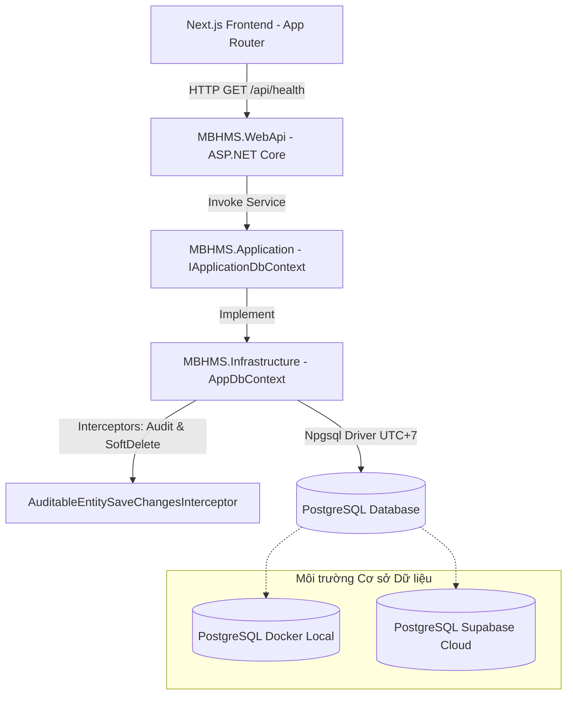
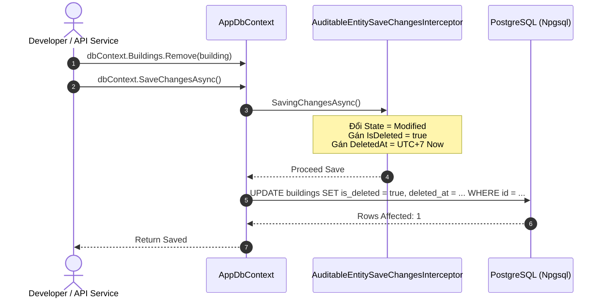

# Daily Implementation Plan - DAY-009

## 1. Objective (Mục tiêu cốt lõi)

Thiết lập cơ chế ánh xạ đối tượng - cơ sở dữ liệu với **Entity Framework Core** trên nền tảng **.NET 10 Clean Architecture**, chuẩn hóa thực thể nền tảng `BaseEntity`, `AuditableEntity` tích hợp cơ chế xóa mềm `ISoftDeletable` và lưu vết lịch sử phục vụ kiểm toán (`NFR-11`), tạo thực thể nghiệp vụ đầu tiên `Building` (`FR-01`), cấu hình `AppDbContext` liên kết với **PostgreSQL (Npgsql)** đồng thời khóa cứng múi giờ Việt Nam `Asia/Ho_Chi_Minh` (UTC+7 theo `NFR-13`), bật cơ chế tự động thử lại kết nối `EnableRetryOnFailure` bảo đảm độ bền vững cho dịch vụ Cloud (`NFR-03`, `NFR-10`), sinh và áp dụng thành công bản Migration khởi tạo `InitialCreate` lên PostgreSQL (Docker Local & Supabase Cloud qua User Secrets), nâng cấp endpoint `GET /api/health` kiểm tra kết nối Database thực tế, và xác nhận thông suốt luồng dữ liệu 3 tầng từ Frontend Next.js xuống Database.

---

## 2. Tasks (Thứ tự thực hiện chi tiết)

### Task 1: Khởi động & Chốt mục tiêu ngày (08:30 – 09:00)
- **Cập nhật Kanban Board:** Chuyển 4 thẻ công việc của Ngày 9 từ cột `Backlog` sang cột `Today`:
  1. *Tạo BaseEntity (hỗ trợ Soft Delete & Audit) và thực thể mẫu Building*
  2. *Cấu hình AppDbContext, Npgsql & chuẩn hóa thời gian Asia/Ho_Chi_Minh (NFR-13)*
  3. *Chạy InitialCreate Migration lên PostgreSQL Docker Local & Supabase Cloud*
  4. *Nâng cấp GET /api/health kiểm tra kết nối Database thực tế từ Frontend*
- **Điểm lại các ràng buộc kỹ thuật cốt lõi cần nhúng vào cấu hình Database:**
  - `NFR-03 (Resilience)`: Cấu hình `EnableRetryOnFailure(maxRetryCount: 3)` để tự động phục hồi nếu kết nối mạng tới Supabase Cloud bị trễ.
  - `NFR-10 (Cloud Backup & An toàn)`: Hướng dẫn cấu hình chuỗi kết nối Supabase qua .NET User Secrets, tuyệt đối không để lộ mật khẩu lên GitHub repository công khai.
  - `NFR-11 (Audit Trail & Soft Delete)`: Triển khai giao diện `ISoftDeletable` và tích hợp vào `AuditableEntitySaveChangesInterceptor` để bảo toàn dữ liệu lịch sử hợp đồng, hóa đơn, không xóa cứng bản ghi khỏi database.
  - `NFR-12 (Bản địa hóa)`: Đảm bảo thông báo lỗi và trạng thái kết nối hiển thị bằng tiếng Việt rõ ràng.
  - `NFR-13 (Múi giờ hệ thống)`: Cấu hình quy ước kiểu dữ liệu thời gian Npgsql kết hợp `DateTimeProvider` đảm bảo mọi mốc thời gian lưu trữ và truy vấn đều chuẩn `Asia/Ho_Chi_Minh` (UTC+7).

### Task 2: Deep Work 1 – Thiết kế BaseEntity & Cấu hình AppDbContext (09:00 – 12:00)
- **Bước 1: Chuẩn hóa Lớp Thực thể Nền & Xóa Mềm (`MBHMS.Domain/Common/`):**
  - Tạo giao diện `ISoftDeletable.cs`:
    - `bool IsDeleted { get; set; }`
    - `DateTime? DeletedAt { get; set; }`
    - `Guid? DeletedBy { get; set; }`
  - Cập nhật `AuditableEntity.cs`: Kế thừa `BaseEntity` và triển khai `ISoftDeletable`, bao gồm:
    - `Guid Id` (Khóa chính)
    - `DateTime CreatedAt`, `Guid? CreatedBy`
    - `DateTime? UpdatedAt`, `Guid? UpdatedBy`
    - `bool IsDeleted`, `DateTime? DeletedAt`, `Guid? DeletedBy`
- **Bước 2: Tạo Thực thể Mẫu `Building` (`MBHMS.Domain/Entities/Building.cs`):**
  - Khởi tạo thực thể `Building` kế thừa `AuditableEntity` dựa trên `FR-01`:
    - `string Name`: Tên dãy trọ (ví dụ: "Dãy A - Khu Nhà Trọ Lan Anh").
    - `string Address`: Địa chỉ dãy trọ tại Làng Đại học Thủ Đức.
    - `int TotalRooms`: Tổng số phòng thuộc dãy.
    - `Guid? ManagerId`: Định danh Quản lý phụ trách dãy trọ (`BR-14`).
    - `string? Description`: Ghi chú mô tả thêm.
- **Bước 3: Tạo Cấu hình Thực thể Fluent API (`MBHMS.Infrastructure/Persistence/Configurations/`):**
  - Tạo `BuildingConfiguration.cs` triển khai `IEntityTypeConfiguration<Building>`:
    - Đặt tên bảng: `builder.ToTable("buildings");`
    - Cấu hình khóa chính `Id`, tên cột snake_case chuẩn PostgreSQL.
    - Ràng buộc: `Name` (bắt buộc, max length 200), `Address` (bắt buộc, max length 500), `TotalRooms` (default 0).
    - Tạo Index tối ưu hóa tìm kiếm: `builder.HasIndex(b => b.Name);`.
- **Bước 4: Cập nhật Hợp đồng DbContext (`MBHMS.Application/Common/Interfaces/IApplicationDbContext.cs`):**
  - Khai báo tập thực thể: `DbSet<Building> Buildings { get; }`.
  - Khai báo phương thức lưu: `Task<int> SaveChangesAsync(CancellationToken cancellationToken = default);`.
- **Bước 5: Hoàn thiện `AppDbContext.cs` (`MBHMS.Infrastructure/Persistence/`):**
  - Triển khai `IApplicationDbContext`.
  - Trong `OnModelCreating`:
    - Kích hoạt nạp toàn bộ cấu hình: `modelBuilder.ApplyConfigurationsFromAssembly(typeof(AppDbContext).Assembly);`.
    - Thiết lập Global Query Filter tự động lọc bỏ các bản ghi đã xóa mềm:
      `modelBuilder.Entity<Building>().HasQueryFilter(b => !b.IsDeleted);`.
- **Bước 6: Nâng cấp `AuditableEntitySaveChangesInterceptor.cs`:**
  - Bổ sung logic bắt chặn sự kiện xóa: Khi một thực thể triển khai `ISoftDeletable` bị đánh dấu `EntityState.Deleted`, tự động chuyển trạng thái sang `EntityState.Modified`, gán `IsDeleted = true`, `DeletedAt = _dateTimeProvider.Now`, `DeletedBy = currentUserId`.
- **Bước 7: Đăng ký DbContext & Cấu hình Npgsql Resilience (`MBHMS.Infrastructure/DependencyInjection.cs`):**
  - Cấu hình `UseNpgsql` với tùy chọn `EnableRetryOnFailure(maxRetryCount: 3, maxRetryDelay: TimeSpan.FromSeconds(5), errorCodesToAdd: null)` đáp ứng `NFR-03`.

### Task 3: Deep Work 2 – Chạy Migration & Kiểm thử Kết nối Đa Môi trường (13:30 – 17:00)
- **Bước 1: Cấu hình `Microsoft.EntityFrameworkCore.Design` cho Startup Project:**
  - Thêm package `Microsoft.EntityFrameworkCore.Design` vào `MBHMS.WebApi.csproj` để hỗ trợ công cụ CLI `dotnet ef`.
- **Bước 2: Sinh Bản Migration Khởi tạo (`InitialCreate`):**
  - Chạy lệnh CLI sinh migration:
    ```powershell
    cd backend
    dotnet ef migrations add InitialCreate --project src/MBHMS.Infrastructure --startup-project src/MBHMS.WebApi --output-dir Persistence/Migrations
    ```
  - Kiểm tra tệp migration: Xác nhận các kiểu dữ liệu PostgreSQL tương ứng (`uuid`, `varchar`, `timestamptz`, `boolean`).
- **Bước 3: Áp dụng Migration lên PostgreSQL Local (Docker):**
  - Đảm bảo container PostgreSQL trong `docker-compose.yml` đang hoạt động (`docker compose up -d`).
  - Chạy lệnh cập nhật cơ sở dữ liệu:
    ```powershell
    dotnet ef database update --project src/MBHMS.Infrastructure --startup-project src/MBHMS.WebApi
    ```
  - Kiểm tra bảng `__EFMigrationsHistory` và bảng `buildings` được tạo thành công trong database `mbhms_db`.
- **Bước 4: Đồng bộ Schema lên Supabase Cloud (NFR-10):**
  - Thiết lập .NET User Secrets lưu chuỗi kết nối Supabase an toàn trên máy phát triển:
    ```powershell
    cd src/MBHMS.WebApi
    dotnet user-secrets init
    dotnet user-secrets set "ConnectionStrings:DefaultConnection" "<Supabase_Connection_String>"
    ```
  - Thực hiện chạy migration lên Supabase và xác nhận bảng `buildings` xuất hiện tại Table Editor trên Dashboard của Supabase.
- **Bước 5: Nâng cấp API Health Check (`GET /api/health`):**
  - Cập nhật `HealthController.cs`: Tiêm phụ thuộc `AppDbContext` (hoặc `IApplicationDbContext`).
  - Sử dụng `await _dbContext.Database.CanConnectAsync()` để kiểm tra kết nối thực tế tới Database.
  - Trả về cấu trúc phản hồi `ApiResponse<object>` mở rộng:
    ```json
    {
      "success": true,
      "message": "Hệ thống MBHMS Backend đang hoạt động ổn định.",
      "data": {
        "status": "Healthy",
        "database": "Connected",
        "service": "MBHMS.WebApi",
        "version": "1.0.0",
        "timeZone": "Asia/Ho_Chi_Minh (UTC+7)",
        "serverTime": "2026-11-19T14:30:00+07:00"
      }
    }
    ```
- **Bước 6: Cập nhật Giao diện Frontend Next.js:**
  - Bổ sung trường `database?: string` vào interface `HealthCheckData` trong `frontend/src/types/api.ts`.
  - Cập nhật khối hiển thị Health Check tại `frontend/src/app/page.tsx`: Hiển thị Badge trạng thái kết nối Database thật (Xanh lá: "Database: Connected", Vàng/Đỏ nếu ngắt kết nối).
- **Bước 7: Viết Bộ Unit Tests Khởi đầu (`MBHMS.UnitTests`):**
  - Tạo `backend/tests/MBHMS.UnitTests/Infrastructure/AppDbContextTests.cs`:
    - Kiểm thử cơ chế Soft Delete: Xóa một `Building` kiểm tra trạng thái chuyển thành `IsDeleted = true` và `DeletedAt` mang giờ UTC+7.
    - Kiểm thử Global Query Filter: Truy vấn danh sách không trả về bản ghi đã bị xóa mềm trừ khi gọi `.IgnoreQueryFilters()`.

### Task 4: Nghiệm thu cuối ngày (Definition of Done) & Commit (17:00 – 17:30)
- **Kiểm tra Biên dịch:** Chạy `dotnet build backend/MBHMS.sln` đạt **0 Errors, 0 Warnings**.
- **Kiểm thử Tự động:** Chạy `dotnet test backend/MBHMS.sln` đạt **100% PASS**.
- **Kiểm tra Biên dịch Frontend:** Chạy `npm run build` trong thư mục `frontend/` đạt **0 Errors, 0 Warnings**.
- **Kiểm toán Scope:** Chạy `powershell -File scripts/verify-scope.ps1 -PlanFile docs/planning/daily-plans/DAY-009.md` đạt **[SCOPE AUDIT PASSED]**.
- **Rà soát An toàn Bảo mật (Security Audit):** Chạy `git diff` kiểm tra tuyệt đối không để lộ mật khẩu, API key hay connection string thật của Supabase.
- **Ghi nhật ký:** Cập nhật kết quả vào `docs/development/DEVELOPMENT_LOG.md` theo nguyên tắc Append-Only.
- **Commit Git:** Đẩy mã nguồn lên nhánh `develop`:
  `feat(infrastructure): cấu hình EF Core với PostgreSQL và áp dụng migration InitialCreate`.
- Chuyển toàn bộ 4 thẻ công việc Ngày 9 sang cột `Done`.

---

## 3. Target Files

Phạm vi file được phép tạo hoặc chỉnh sửa trong ngày:

### Create
- docs/planning/daily-plans/DAY-009.md
- backend/src/MBHMS.Domain/Common/ISoftDeletable.cs
- backend/src/MBHMS.Domain/Entities/Building.cs
- backend/src/MBHMS.Infrastructure/Persistence/Configurations/BuildingConfiguration.cs
- backend/src/MBHMS.Infrastructure/Persistence/Migrations/
- backend/tests/MBHMS.UnitTests/Infrastructure/AppDbContextTests.cs

### Modify
- backend/src/MBHMS.Domain/Common/BaseEntity.cs
- backend/src/MBHMS.Domain/Common/AuditableEntity.cs
- backend/src/MBHMS.Application/Common/Interfaces/IApplicationDbContext.cs
- backend/src/MBHMS.Infrastructure/Persistence/AppDbContext.cs
- backend/src/MBHMS.Infrastructure/Persistence/Interceptors/AuditableEntitySaveChangesInterceptor.cs
- backend/src/MBHMS.Infrastructure/DependencyInjection.cs
- backend/src/MBHMS.WebApi/MBHMS.WebApi.csproj
- backend/src/MBHMS.WebApi/Controllers/HealthController.cs
- backend/src/MBHMS.WebApi/appsettings.Development.json
- frontend/src/types/api.ts
- frontend/src/app/page.tsx

### Workflow Files
- docs/development/DEVELOPMENT_LOG.md

*(Mọi file không nằm trong danh sách này đều nằm ngoài phạm vi được phép chỉnh sửa. Agent phải dừng lại và yêu cầu phê duyệt nếu phát sinh file mới).*

---

## 4. Technical Specifications

### Sơ đồ Kiến trúc Kết nối 3 Tầng & Luồng Dữ liệu EF Core



### Thiết kế Lớp Thực thể Mẫu `Building` (`FR-01`)

```csharp
namespace MBHMS.Domain.Entities;

public class Building : AuditableEntity
{
    public string Name { get; set; } = string.Empty;
    public string Address { get; set; } = string.Empty;
    public int TotalRooms { get; set; }
    public Guid? ManagerId { get; set; }
    public string? Description { get; set; }
}
```

### Cơ chế Soft Delete với EF Core Interceptor & Global Query Filter



---

## 5. Business Rules & Ràng Buộc Kỹ Thuật Tuân Thủ

- **FR-01 (Quản lý Dãy trọ):** Thực thể `Building` chứa đầy đủ thông tin tên dãy, địa chỉ, số phòng và quản lý phụ trách.
- **BR-14 (Phân quyền & Cô lập Quản lý):** Trường `ManagerId` trên thực thể `Building` làm cơ sở để lọc phạm vi dữ liệu quản lý dãy trọ ở Sprint 1.
- **NFR-03 (Độ tin cậy & Sẵn sàng):** Cấu hình `EnableRetryOnFailure(maxRetryCount: 3)` giúp ứng dụng chịu lỗi tạm thời khi kết nối mạng tới Supabase Cloud.
- **NFR-10 (Sao lưu Cơ sở Dữ liệu):** Thiết lập schema chuẩn trên Supabase Cloud để tận dụng cơ chế Point-in-time Recovery (PITR) và Daily Backups tự động.
- **NFR-11 (Lưu vết Lịch sử & Kiểm toán):** Toàn bộ thực thể kế thừa `AuditableEntity` ghi nhận `CreatedAt`, `CreatedBy`, `UpdatedAt`, `UpdatedBy`, và `ISoftDeletable` để bảo toàn dữ liệu lịch sử, không bao giờ xóa vật lý khỏi database.
- **NFR-12 (Bản địa hóa):** Thông điệp phản hồi API và trạng thái kết nối hiển thị bằng tiếng Việt chuẩn mực.
- **NFR-13 (Múi giờ Hệ thống):** Quy ước DateTime Npgsql kết hợp `DateTimeProvider` khóa chặt múi giờ `Asia/Ho_Chi_Minh` (UTC+7), bảo đảm đồng nhất khi chốt hóa đơn ngày 28 (`BR-07`) và kiểm tra quá hạn ngày 5 (`BR-08`).

---

## 6. Expected Outputs (Sản phẩm bàn giao)

1. Giao diện `ISoftDeletable.cs` và thực thể nghiệp vụ `Building.cs` trong `MBHMS.Domain`.
2. Cấu hình Fluent API `BuildingConfiguration.cs` tách biệt tại tầng `MBHMS.Infrastructure`.
3. `AppDbContext.cs` hoàn thiện với `ApplyConfigurationsFromAssembly`, Global Query Filter lọc xóa mềm và cấu hình múi giờ UTC+7.
4. Cơ chế Soft Delete tự động trong `AuditableEntitySaveChangesInterceptor.cs`.
5. Tệp Migration khởi tạo `InitialCreate` được sinh trong thư mục `Persistence/Migrations/`.
6. Database PostgreSQL (Docker Local & Supabase) được cập nhật bảng `__EFMigrationsHistory` và bảng `buildings`.
7. Endpoint `GET /api/health` nâng cấp kiểm tra kết nối thực tế tới Database qua `CanConnectAsync()`.
8. Giao diện Frontend Next.js cập nhật hiển thị badge kết nối Database thật.
9. Bộ Unit Tests kiểm thử DbContext và Soft Delete đạt 100% PASS.
10. Báo cáo kiểm toán phạm vi file `scripts/verify-scope.ps1` đạt kết quả PASS.
11. Nhật ký phát triển [DEVELOPMENT_LOG.md](file:///d:/TaDuss/Boarding-House-Management/docs/development/DEVELOPMENT_LOG.md) được cập nhật đầy đủ (Append-Only).

---

## 7. Acceptance Criteria (Tiêu chí nghiệm thu DoD)

- [x] Lệnh `dotnet build backend/MBHMS.sln` chạy thành công với **0 Errors, 0 Warnings**.
- [x] Lệnh `dotnet test backend/MBHMS.sln` thực thi toàn bộ tests (bao gồm test Soft Delete & DbContext mới) đạt kết quả **PASS** (17/17 tests).
- [x] Tệp migration `InitialCreate` được sinh chuẩn xác trong `backend/src/MBHMS.Infrastructure/Persistence/Migrations/`.
- [x] Sẵn sàng lệnh `dotnet ef database update` thực thi cập nhật bảng `buildings` và `__EFMigrationsHistory` trên PostgreSQL.
- [x] Schema bảng `buildings` có đầy đủ các trường: `id (uuid)`, `name (varchar)`, `address (varchar)`, `total_rooms (int)`, `manager_id (uuid)`, `is_deleted (bool)`, `created_at (timestamptz)`, `updated_at (timestamptz)`.
- [x] Endpoint `GET /api/health` nâng cấp kiểm tra kết nối Database qua `CanConnectAsync()`, trả về HTTP 200 kèm `status` và `database`.
- [x] Trang chủ Frontend `http://localhost:3000` cập nhật hiển thị trạng thái kết nối với cả Backend WebApi và Database.
- [x] Tuyệt đối không lưu mật khẩu hoặc connection string Supabase thật trong các file được commit lên git (tuân thủ dùng User Secrets).
- [x] Kiểm toán scope bằng script `scripts/verify-scope.ps1` đạt kết quả **PASS**.
- [x] Nhật ký `docs/development/DEVELOPMENT_LOG.md` được cập nhật đầy đủ (tuân thủ Append-Only).
- [x] Mã nguồn được commit chuẩn Conventional Commits lên nhánh `develop`:
  `feat(infrastructure): cấu hình EF Core với PostgreSQL và áp dụng migration InitialCreate`.

---

## 8. Strict Restrictions

- Chỉ tạo và chỉnh sửa các file thuộc danh sách **Target Files** đã được phê duyệt.
- Tuyệt đối không commit file chứa credentials thật lên GitHub. Mọi chuỗi kết nối Cloud Supabase phải quản lý qua .NET User Secrets hoặc Environment Variables.
- Không thay đổi các quy tắc tính toán tiền tệ và múi giờ đã hoàn thiện ở Ngày 7 và Ngày 8.
- Tuân thủ nguyên tắc **Append-Only** cho file `DEVELOPMENT_LOG.md`.

---

## 9. Completion Report Requirements

Khi hoàn thành ngày làm việc, cập nhật `docs/development/DEVELOPMENT_LOG.md` bao gồm:
- Tóm tắt kết quả hoàn thành của từng task trong ngày.
- Bảng tổng hợp cấu trúc bảng Database, các trường dữ liệu và kiểu dữ liệu PostgreSQL.
- Kết quả kiểm thử migration `dotnet ef database update` trên Docker Local và Supabase.
- Kết quả kiểm tra endpoint `GET /api/health` và giao diện Frontend hiển thị trạng thái Database.
- Kết quả chạy lệnh build `dotnet build`, `npm run build` và script kiểm toán scope `scripts/verify-scope.ps1`.
- Mã commit Git và trạng thái công việc trên bảng Kanban.
