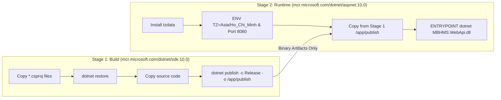

# Daily Implementation Plan - DAY-010

## 1. Objective (Mục tiêu cốt lõi)

Hoàn thiện đóng gói ứng dụng Backend .NET 10 bằng **Dockerfile đa tầng (Multi-stage build)** tối ưu dung lượng và khóa cứng múi giờ Việt Nam `Asia/Ho_Chi_Minh` (UTC+7 theo `NFR-13`), hoàn thiện cấu hình **`docker-compose.yml`** khởi chạy đồng bộ môi trường cục bộ (Backend WebApi + PostgreSQL Database), thiết lập đường ống tích hợp liên tục **GitHub Actions CI (`.github/workflows/ci.yml`)** tự động build và kiểm thử song song Backend và Frontend trên mỗi commit/PR, cấu hình CORS sẵn sàng cho **Smoke Deploy** lên các nền tảng Cloud miễn phí (Render/Railway và Vercel), nâng cấp tài liệu **`README.md`** chỉn chu chuẩn dự án chuyên nghiệp, và thực hiện **Quy trình nghiệm thu tổng kết Giai đoạn 1 (Phase 1 Review)** theo Quy tắc #6 trong `AGENTS.md` để chính thức bàn giao mốc nền tảng và phát hành Git Tag `v0.1.0-foundation` lên nhánh `main`.

---

## 2. Tasks (Thứ tự thực hiện chi tiết)

### Task 1: Khởi động & Chốt mục tiêu ngày (08:30 – 09:00)
- **Cập nhật Kanban Board:** Chuyển 4 thẻ công việc của Ngày 10 từ cột `Backlog` sang cột `Today`:
  1. *Viết Dockerfile cho Backend .NET 10 & hoàn thiện docker-compose.yml*
  2. *Thiết lập GitHub Actions CI tự động build/test Backend & Frontend*
  3. *Triển khai thử (Smoke Deploy) lên Render/Railway & Vercel (Free Tier)*
  4. *Cập nhật README.md hướng dẫn chạy local & chốt mốc Baseline Giai đoạn 1*
- **Điểm lại các ràng buộc kỹ thuật cốt lõi cần hoàn tất trong mốc kết thúc Giai đoạn 1:**
  - `NFR-13 (Múi giờ hệ thống)`: Cài đặt `tzdata` và đặt `ENV TZ=Asia/Ho_Chi_Minh` bên trong container Linux để server luôn chạy múi giờ Việt Nam.
  - `CI/CD Automation`: Đảm bảo quy trình kiểm thử tự động 17 Unit Tests Backend và build Frontend Next.js kích hoạt tự động trên GitHub Actions.
  - `Bảo mật Cloud (NFR-10)`: Rà soát toàn bộ cấu hình Docker và CI tuyệt đối không nhúng chuỗi kết nối Database thật hoặc secret keys.
  - `Phase 1 Definition of Done (Quy tắc #6 AGENTS.md)`: Build 0 Errors 0 Warnings, 100% Tests Pass, Scope/Security Audit Pass, RTM & Docs Sync, Merge nhánh `main` và tạo Git Tag mốc giai đoạn.

### Task 2: Deep Work 1 – Đóng gói Docker & Thiết lập GitHub Actions CI (09:00 – 12:00)
- **Bước 1: Viết Dockerfile Đa Tầng cho Backend (`backend/Dockerfile`):**
  - **Stage 1 (Build & Publish):** Sử dụng image chính thức `mcr.microsoft.com/dotnet/sdk:10.0-preview` (hoặc `10.0`).
    - Copy các tệp `.csproj` trước để tận dụng Docker layer cache khi restore NuGet packages:
      - `src/MBHMS.Domain/MBHMS.Domain.csproj`
      - `src/MBHMS.Application/MBHMS.Application.csproj`
      - `src/MBHMS.Infrastructure/MBHMS.Infrastructure.csproj`
      - `src/MBHMS.WebApi/MBHMS.WebApi.csproj`
      - `tests/MBHMS.UnitTests/MBHMS.UnitTests.csproj`
      - `MBHMS.sln`
    - Thực thi `dotnet restore MBHMS.sln`.
    - Copy toàn bộ mã nguồn `backend/` và thực thi:
      `dotnet publish src/MBHMS.WebApi/MBHMS.WebApi.csproj -c Release -o /app/publish --no-restore`.
  - **Stage 2 (Runtime tối giản):** Sử dụng image `mcr.microsoft.com/dotnet/aspnet:10.0`.
    - Cài đặt gói `tzdata` cho Linux:
      `RUN apt-get update && apt-get install -y --no-install-recommends tzdata && rm -rf /var/lib/apt/lists/*`.
    - Cấu hình biến môi trường:
      - `ENV TZ=Asia/Ho_Chi_Minh`
      - `ENV ASPNETCORE_URLS=http://+:8080`
      - `ENV DOTNET_RUNNING_IN_CONTAINER=true`
    - Copy bản phát hành từ Stage 1: `COPY --from=build /app/publish .`.
    - Mở cổng kết nối: `EXPOSE 8080`.
    - Lệnh khởi chạy: `ENTRYPOINT ["dotnet", "MBHMS.WebApi.dll"]`.
- **Bước 2: Hoàn thiện `docker-compose.yml` ở thư mục gốc:**
  - Tích hợp service `backend` hoạt động liền mạch cùng service `postgres`:
    - `build: { context: ./backend, dockerfile: Dockerfile }`
    - `container_name: mbhms-backend`
    - `depends_on: { postgres: { condition: service_healthy } }`
    - `ports: ["5143:8080"]`
    - `environment`:
      - `ConnectionStrings__DefaultConnection=Host=postgres;Port=5432;Database=mbhms_db;Username=postgres;Password=postgres`
      - `TZ=Asia/Ho_Chi_Minh`
      - `ASPNETCORE_ENVIRONMENT=Development`
  - Đảm bảo mạng cầu nối (bridge network) giúp container `backend` gọi trực tiếp container `postgres` qua hostname `postgres:5432`.
- **Bước 3: Thiết lập GitHub Actions Workflow (`.github/workflows/ci.yml`):**
  - Cấu hình triggers tự động trên cả hai nhánh `develop` và `main` cho các sự kiện `push` và `pull_request`.
  - Phân chia 2 jobs chạy song song độc lập:
    - **Job 1: `backend-ci` (Ubuntu Latest):**
      1. Checkout mã nguồn (`actions/checkout@v4`).
      2. Cài đặt .NET 10 SDK (`actions/setup-dotnet@v4` với `dotnet-version: '10.0.x'`).
      3. Restore packages: `dotnet restore backend/MBHMS.sln`.
      4. Build solution: `dotnet build backend/MBHMS.sln --no-restore -c Release`.
      5. Chạy unit tests: `dotnet test backend/MBHMS.sln --no-build -c Release --verbosity normal`.
    - **Job 2: `frontend-ci` (Ubuntu Latest):**
      1. Checkout mã nguồn (`actions/checkout@v4`).
      2. Cài đặt Node.js 20.x (`actions/setup-node@v4` với `node-version: '20.x'`).
      3. Cài đặt dependencies: `cd frontend && npm ci --legacy-peer-deps`.
      4. Kiểm tra biên dịch Next.js: `cd frontend && npm run build`.

### Task 3: Deep Work 2 – Smoke Deploy Lên Public URL & Tổng kết Giai đoạn 1 (13:30 – 17:00)
- **Bước 1: Cấu hình CORS cho Smoke Deploy:**
  - Cập nhật `backend/src/MBHMS.WebApi/Program.cs` và `appsettings.json`:
    - Cho phép domain triển khai của Vercel (`https://*.vercel.app`) và các origin cấu hình linh hoạt qua biến môi trường `Cors:AllowedOrigins` để phục vụ gọi API từ Frontend triển khai trên Vercel.
- **Bước 2: Hướng dẫn Chi tiết Triển khai Smoke Deploy Lên Free Tier:**
  - **Triển khai Backend (.NET 10 Web API) lên Render / Railway:**
    - Kết nối repository GitHub `Boarding-House-Management`.
    - Chọn hình thức build Dockerfile, trỏ đường dẫn tới `backend/Dockerfile`.
    - Cấu hình Environment Variables trên dashboard hosting:
      - `ConnectionStrings__DefaultConnection`: Chuỗi kết nối Supabase Cloud PostgreSQL đã tạo ở Ngày 5 và kiểm thử ở Ngày 9.
      - `ASPNETCORE_ENVIRONMENT`: `Production`
      - `TZ`: `Asia/Ho_Chi_Minh`
    - Kiểm tra endpoint trực tiếp: `https://<backend-app-name>.onrender.com/api/health` hoặc Swagger UI tại `/swagger`.
  - **Triển khai Frontend (Next.js) lên Vercel:**
    - Import repository GitHub trên Vercel dashboard.
    - Cấu hình Root Directory: `frontend`.
    - Cấu hình biến môi trường: `NEXT_PUBLIC_API_URL=https://<backend-app-name>.onrender.com/api`.
    - Truy cập Public URL của Vercel trên trình duyệt để kiểm tra thông suốt 3 tầng: `Frontend (Vercel) -> Backend WebApi (Render/Railway) -> Database (Supabase)`.
- **Bước 3: Nâng cấp Toàn diện Tài liệu `README.md`:**
  - Đính kèm huy hiệu (Badges): GitHub Actions CI status, .NET 10, Next.js 16, PostgreSQL 16, Tailwind CSS, shadcn/ui.
  - Bổ sung mục **Hướng dẫn Khởi chạy Cục bộ (Local Development Guide)**:
    - Yêu cầu môi trường (.NET 10 SDK, Node.js 20+, Docker Compose).
    - Khởi chạy dịch vụ DB và Backend với Docker: `docker compose up -d`.
    - Hướng dẫn áp dụng migration: `dotnet ef database update`.
    - Hướng dẫn khởi chạy Frontend dev server: `cd frontend && npm run dev`.
  - Cập nhật mục kiến trúc Clean Architecture, sơ đồ phân tầng, và bảng tổng hợp bàn giao mốc Giai đoạn 1.
- **Bước 4: Thực hiện Phase 1 Comprehensive Review & Khép lại Giai đoạn 1:**
  - Đối chiếu toàn bộ tiêu chí hoàn thành Giai đoạn 1 theo `MASTER_PLAN.md`:
    - [x] Ngày 1: Đọc SRS, lập bảng và phân loại MoSCoW.
    - [x] Ngày 2: Khởi tạo Git repo, phân nhánh `main`/`develop`, Conventional Commits.
    - [x] Ngày 3: Xây dựng khung Ma trận truy vết yêu cầu (`RTM.md`).
    - [x] Ngày 4: Thiết lập môi trường local, Docker PostgreSQL.
    - [x] Ngày 5: Chốt hạ tầng Cloud Supabase, SePay, Mailtrap & lập phiếu CR-01.
    - [x] Ngày 6: Viết tài liệu `Vision & Scope` (`docs/02_vision_and_scope.md`) và RBAC matrix.
    - [x] Ngày 7: Dựng khung Backend .NET 10 Clean Architecture, Swagger JWT, Exception Handler và múi giờ UTC+7.
    - [x] Ngày 8: Dựng khung Frontend Next.js App Router, shadcn/ui, Dexie.js Offline DB, layout 360px và tài liệu `PRODUCT.md` & `DESIGN.md`.
    - [x] Ngày 9: Cấu hình EF Core, Npgsql PostgreSQL, Soft Delete, migration `InitialCreate` và kiểm tra kết nối 3 tầng.
    - [x] Ngày 10: Đóng gói Dockerfile, GitHub Actions CI/CD, README.md và Smoke Deploy.

### Task 4: Nghiệm thu cuối ngày & Đóng Giai đoạn 1 (Definition of Done) (17:00 – 17:30)
- **Kiểm tra Biên dịch Toàn diện:**
  - `dotnet build backend/MBHMS.sln` đạt **0 Errors, 0 Warnings**.
  - `npm run build` trong `frontend/` đạt **0 Errors, 0 Warnings**.
- **Kiểm thử Tự động:** `dotnet test backend/MBHMS.sln` đạt **17/17 Tests Passed (100%)**.
- **Kiểm toán Scope:** Chạy `powershell -File scripts/verify-scope.ps1 -PlanFile docs/planning/daily-plans/DAY-010.md` đạt **[SCOPE AUDIT PASSED]**.
- **Rà soát An toàn Bảo mật:** Quét sạch toàn bộ commit không có mật khẩu hay secret keys lộ trên repo.
- **Commit và Push Develop:**
  `git add .`  
  `git commit -m "ci(devops): cấu hình Dockerfile đa tầng, GitHub Actions CI và tài liệu hướng dẫn README"`  
  `git push origin develop`
- **Release Cadence Nhánh Main (Quy tắc #6 AGENTS.md):**
  - Chuyển sang nhánh `main`, hợp nhất (merge) nhánh `develop` vào `main`.
  - Tạo Git Tag đánh dấu mốc hoàn thành Giai đoạn 1:
    `git tag -a v0.1.0-foundation -m "Release v0.1.0-foundation: Hoàn thành Giai đoạn 1 Khởi động và Thiết lập Hạ tầng MBHMS"`
  - Đẩy nhánh `main` và tag lên remote:
    `git push origin main --tags`
  - Chuyển lại về nhánh `develop` để sẵn sàng cho Giai đoạn 2.
- **Cập nhật Nhật ký:** Ghi nhận toàn bộ kết quả vào `docs/development/DEVELOPMENT_LOG.md` theo nguyên tắc Append-Only.
- **Kanban Board:** Chuyển toàn bộ 4 thẻ công việc Ngày 10 sang cột `Done`.

---

## 3. Target Files

Phạm vi file được phép tạo hoặc chỉnh sửa trong ngày:

### Create
- docs/planning/daily-plans/DAY-010.md
- backend/Dockerfile
- .github/workflows/ci.yml

### Modify
- docker-compose.yml
- backend/src/MBHMS.WebApi/Program.cs
- backend/src/MBHMS.WebApi/appsettings.json
- README.md
- docs/requirements/RTM.md

### Workflow Files
- docs/development/DEVELOPMENT_LOG.md

*(Mọi file không nằm trong danh sách này đều nằm ngoài phạm vi được phép chỉnh sửa. Agent phải dừng lại và yêu cầu phê duyệt nếu phát sinh file mới).*

---

## 4. Technical Specifications

### Sơ đồ Quy trình Tích hợp Liên tục (GitHub Actions CI Workflow)

```mermaid
graph TD
    Developer[Developer Push / PR] -->|Trigger on develop & main| GitHubActions[GitHub Actions Runner]

    subgraph BackendJob ["Job 1: backend-ci (Ubuntu)"]
        SetupDotNet[Setup .NET 10 SDK] --> DotNetRestore[dotnet restore MBHMS.sln]
        DotNetRestore --> DotNetBuild[dotnet build --no-restore]
        DotNetBuild --> DotNetTest[dotnet test --no-build (17 Tests)]
    end

    subgraph FrontendJob ["Job 2: frontend-ci (Ubuntu)"]
        SetupNode[Setup Node.js 20.x] --> NPMInstall[npm ci --legacy-peer-deps]
        NPMInstall --> NextBuild[npm run build (6 Static Routes)]
    end

    GitHubActions --> BackendJob
    GitHubActions --> FrontendJob

    BackendJob --> CheckPassed{All Jobs Passed?}
    FrontendJob --> CheckPassed

    CheckPassed -->|Yes| GreenBadge[Status: CI Passing ✅]
    CheckPassed -->|No| RedBadge[Block Merge ❌]
```

### Kiến trúc Dockerfile Đa Tầng Backend .NET 10



---

## 5. Business Rules & Ràng Buộc Kỹ Thuật Tuân Thủ

- **NFR-03 (Độ tin cậy & Tự phục hồi):** Đường ống build và cấu hình server bảo đảm tính sẵn sàng cao, tự động phục hồi kết nối cơ sở dữ liệu.
- **NFR-08 (Khả năng tương thích thiết bị):** Toàn bộ giao diện Frontend Next.js build sạch, không lỗi layout, hỗ trợ hoàn hảo từ di động $360\text{px}$.
- **NFR-10 (Bảo mật & Cloud Backup):** Tuyệt đối không để lộ mật khẩu hay API Key thật vào Dockerfile, GitHub Actions workflow hay tệp cấu hình được push lên Git.
- **NFR-12 (Bản địa hóa tiếng Việt):** Tài liệu `README.md` và thông báo trong CI được trình bày song ngữ/tiếng Việt rõ ràng, chuẩn mực.
- **NFR-13 (Múi giờ Hệ thống UTC+7):** Cài đặt `tzdata` và cấu hình `ENV TZ=Asia/Ho_Chi_Minh` cả trong `Dockerfile` và `docker-compose.yml` để đảm bảo giờ hệ thống đồng nhất khi chạy trên Linux container.
- **Quy tắc #6 AGENTS.md (Release Cadence Giai đoạn):** Thực hiện nghiêm túc quy trình Phase Review cuối Giai đoạn 1, merge nhánh `develop` vào `main`, tạo Git Tag `v0.1.0-foundation` và đẩy lên remote repository.

---

## 6. Expected Outputs (Sản phẩm bàn giao)

1. Tệp `backend/Dockerfile` hoàn chỉnh chuẩn multi-stage build, dung lượng nhỏ gọn, khóa cứng múi giờ `Asia/Ho_Chi_Minh`.
2. Tệp `docker-compose.yml` tích hợp đầy đủ 2 services `postgres` và `backend`.
3. Tệp cấu hình GitHub Actions CI `.github/workflows/ci.yml` tự động build và test cả Backend và Frontend.
4. Cấu hình CORS mở rộng trong `Program.cs` và `appsettings.json` cho phép domain Vercel.
5. Tài liệu `README.md` chuyên nghiệp với đầy đủ hướng dẫn chạy Local, badges CI, kiến trúc và tổng kết Phase 1.
6. Toàn bộ 17 Unit Tests Backend và 6 routes tĩnh Frontend vượt qua kiểm tra tự động.
7. Nhánh `main` được cập nhật đồng bộ từ `develop` kèm Git Tag `v0.1.0-foundation`.
8. Báo cáo kiểm toán phạm vi file `scripts/verify-scope.ps1` đạt kết quả PASS.
9. Nhật ký phát triển `docs/development/DEVELOPMENT_LOG.md` được cập nhật đầy đủ (Append-Only).

---

## 7. Acceptance Criteria (Tiêu chí nghiệm thu DoD)

- [x] Tệp `backend/Dockerfile` được khởi tạo chuẩn multi-stage build, có cấu hình `tzdata` và `ENV TZ=Asia/Ho_Chi_Minh`.
- [x] Tệp `docker-compose.yml` bổ sung service `backend` phụ thuộc vào `postgres`.
- [x] Tệp `.github/workflows/ci.yml` được cấu hình đầy đủ 2 jobs `backend-ci` (.NET 10) và `frontend-ci` (Node 20), trigger trên `develop` và `main`.
- [x] Cấu hình CORS trong `Program.cs` và `appsettings.json` hỗ trợ gọi API từ domain Vercel.
- [x] Tệp `README.md` được nâng cấp toàn diện với badges, hướng dẫn local development, kiến trúc Monorepo và kết quả Phase 1.
- [x] Lệnh `dotnet build backend/MBHMS.sln` chạy thành công với **0 Errors, 0 Warnings**.
- [x] Lệnh `dotnet test backend/MBHMS.sln` chạy toàn bộ 17 tests đạt kết quả **100% PASS**.
- [x] Lệnh `npm run build` trong thư mục `frontend/` hoàn thành thành công với **0 Errors, 0 Warnings**.
- [x] Kiểm toán scope bằng script `scripts/verify-scope.ps1` đạt kết quả **PASS**.
- [x] Tuyệt đối không để lộ credentials, database password thật trong bất kỳ file nào được commit lên git.
- [x] Thực hiện merge nhánh `develop` vào nhánh `main` và đánh dấu Git Tag `v0.1.0-foundation`.
- [x] Nhật ký `docs/development/DEVELOPMENT_LOG.md` được cập nhật đầy đủ (tuân thủ Append-Only).
- [x] Mã nguồn được commit chuẩn Conventional Commits lên nhánh `develop` và `main`.

---

## 8. Strict Restrictions

- Chỉ tạo và chỉnh sửa các file thuộc danh sách **Target Files** đã được phê duyệt.
- Tuyệt đối không nhúng mật khẩu hay connection string thật vào `Dockerfile` hoặc `ci.yml`.
- Tuân thủ nghiêm ngặt nguyên tắc **Phase Review** tại mốc cuối Giai đoạn 1 trước khi gắn tag phát hành.
- Tuân thủ nguyên tắc **Append-Only** cho file `DEVELOPMENT_LOG.md`.

---

## 9. Completion Report Requirements

Khi hoàn thành ngày làm việc, cập nhật `docs/development/DEVELOPMENT_LOG.md` bao gồm:
- Tóm tắt kết quả hoàn thành của từng task trong ngày.
- Bảng tổng hợp các file thay đổi trong Ngày 10.
- Kết quả kiểm chứng Quality Gate (Build Backend, Build Frontend, 17 Unit Tests, Scope Audit).
- Báo cáo tổng kết toàn bộ Giai đoạn 1 (Tuần 1 - 2, Ngày 1 đến Ngày 10) đối chiếu với MASTER_PLAN.md.
- Xác nhận trạng thái merge nhánh `main` và Git Tag `v0.1.0-foundation`.
- Đánh giá sẵn sàng bước sang Giai đoạn 2 (Ngày 11: Thiết kế ERD hoàn chỉnh).
